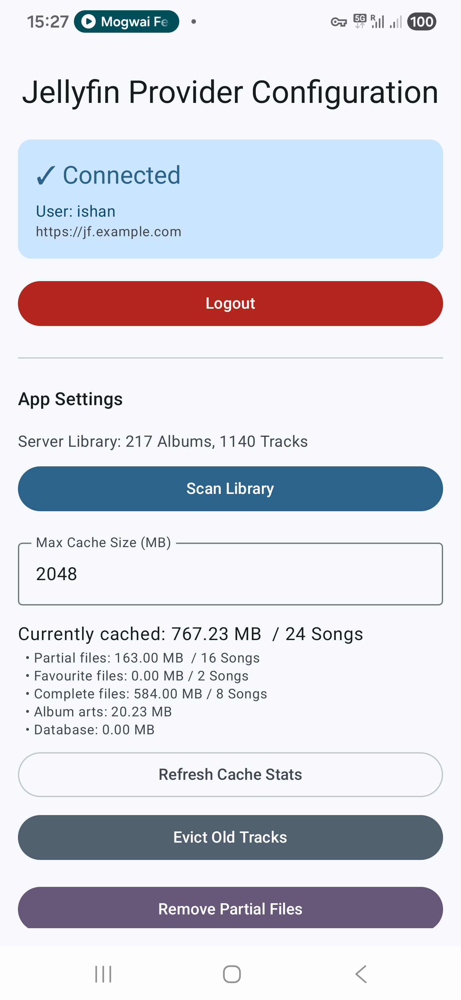
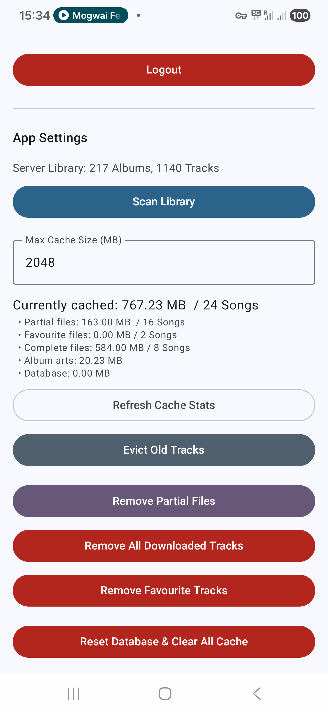

# Jellyfin SAF Provider

This project exposes Music libraries in [Jellyfin](https://jellyfin.org) over Android's Storage Access Framework(SAF).

With this, you can use players that support SAF but not jellyfin. This should work for all such apps but I have built
it specifically to work the best with [Poweramp](https://powerampapp.com/).

# How to download

This is not published on Play Store yet. You can grab the latest APK from [releases section](https://github.com/ishanjain28/jellyfin-saf-provider/releases).

# Screenshots

